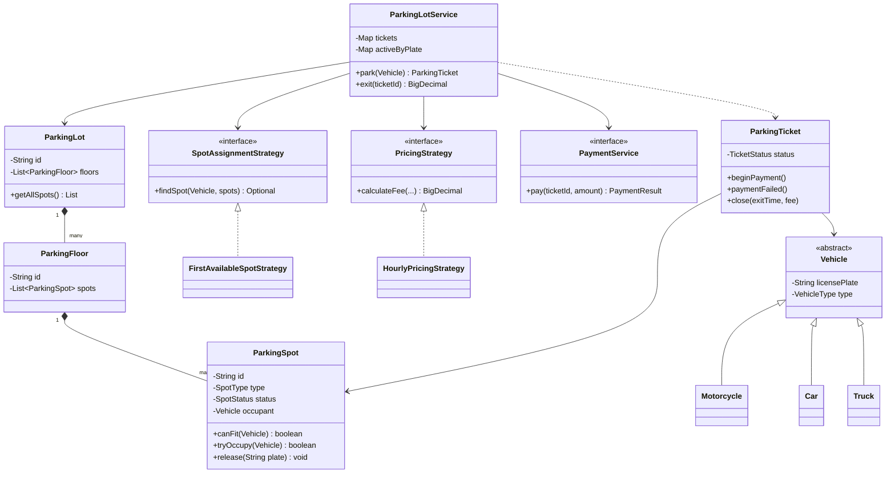
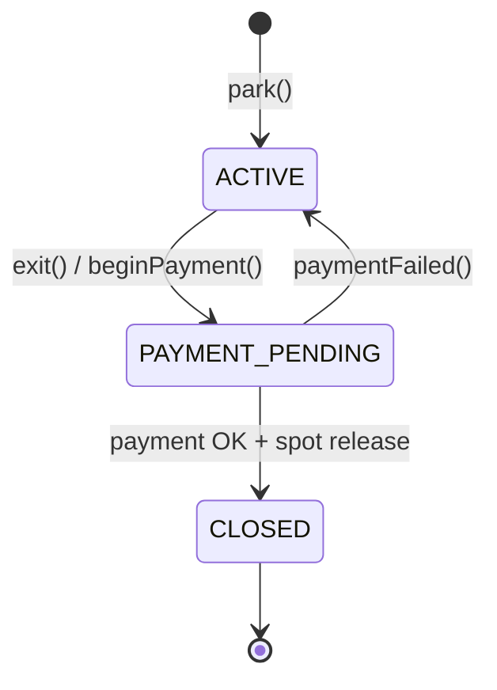

# Low-Level Design — Parking Lot System

**Author:** [vinu-varsidh](https://github.com/vinu-varsidh)

LLD documentation for the Java parking lot in the parent repository.

## Problem scope

Support entry, parking, exit with payment, and spot release for **motorcycles**, **cars**, and **trucks** across **multiple floors**, with pluggable spot assignment and pricing.

## Class diagram (core domain)



## Component responsibilities

| Component | Responsibility |
|-----------|----------------|
| `Vehicle` hierarchy | Identity (plate) + immutable `VehicleType` |
| `ParkingSpot` | Fit rules, atomic occupy/release, per-spot lock |
| `ParkingFloor` / `ParkingLot` | Structural grouping; flattened spot list for assignment |
| `SpotAssignmentStrategy` | Choose one compatible available spot |
| `PricingStrategy` | Compute exit fee from dwell time and vehicle type |
| `PaymentService` | External payment port (mock in demo) |
| `ParkingTicket` | Ticket state machine (`ACTIVE` → `PAYMENT_PENDING` → `CLOSED`) |
| `ParkingLotService` | Orchestrates park/exit; indexes tickets by id and active plate |

## Spot compatibility matrix

| Vehicle \\ Spot | MOTORCYCLE | COMPACT | LARGE |
|-----------------|------------|---------|-------|
| MOTORCYCLE      | Yes        | Yes     | Yes   |
| CAR             | No         | Yes     | Yes   |
| TRUCK           | No         | No      | Yes   |

Implemented in `ParkingSpot.canFit` via switch on `VehicleType`.

## Ticket state machine



Invalid transitions throw `IllegalStateException` inside `ParkingTicket`.

## Sequence: park

1. Reject if plate already in `activeByPlate`.
2. Strategy scans `lot.getAllSpots()` for first available + fitting spot.
3. `tryOccupy(vehicle)` on chosen spot (must succeed under service lock).
4. Issue ticket id `{lotId}-T{n}`, store in `tickets` and `activeByPlate`.

## Sequence: exit

1. Resolve ticket; reject unknown or already `CLOSED`.
2. `beginPayment()` → `PAYMENT_PENDING`.
3. Compute fee; call `PaymentService.pay`.
4. On failure: `paymentFailed()` → remain `ACTIVE`, spot stays occupied.
5. On success: `release(plate)`, `close(exitTime, fee)`, remove from `activeByPlate`.

## Concurrency model

| Layer | Mechanism |
|-------|-----------|
| `ParkingLotService` | `synchronized` methods on service instance — serializes park/exit for that instance |
| `ParkingSpot` | `synchronized` on `isAvailable`, `tryOccupy`, `release` |
| `ParkingTicket` | `synchronized` status transitions and getters |

**Assumption:** One service instance per lot in typical deployment. Multiple service instances sharing the same spot objects would still rely on spot-level locks for occupy/release.

**Gap (documented):** If `tryOccupy` fails after strategy selection, service throws rather than retrying the next candidate. Acceptable when a single service lock serializes parks; extension point is a loop in `park()` over strategy candidates.

## Pricing (hourly)

- Minimum **1 hour** billed.
- Partial hours round **up** to the next hour: `(seconds + 3599) / 3600`.
- Rates keyed by `VehicleType`; amounts use `BigDecimal` with scale 2, `HALF_UP`.

## Extension points

- **Assignment:** nearest exit, VIP, electric charging (`SpotAssignmentStrategy`).
- **Pricing:** flat daily cap, weekend rates (`PricingStrategy`).
- **Payment:** Stripe, UPI adapter (`PaymentService`).
- **Persistence:** replace in-memory maps with repository interfaces.

## Verification

Run the automated checks from the repo root:

```bash
javac --release 17 -d target/classes $(find src/main/java -name '*.java')
java -cp target/classes com.parkinglot.ParkingLotVerification
```

See `../src/main/java/com/parkinglot/ParkingLotVerification.java` for scenarios covered.
