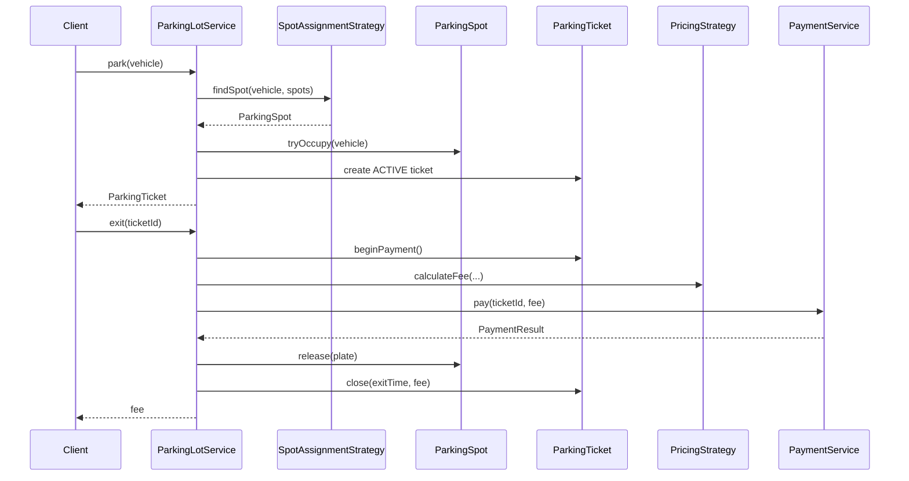

# Parking Lot System (Java)

A small, thread-aware parking lot domain model: vehicles park in typed spots across floors, receive tickets, pay on exit via pluggable pricing and payment, and release spots when payment succeeds.

**Requirements:** Java 17+ (records, switch expressions, `Map.copyOf`).

## Quick start

With Maven:

```bash
mvn compile exec:java
```

Without Maven:

```bash
mkdir -p target/classes
find src/main/java -name '*.java' | xargs javac --release 17 -d target/classes
java -cp target/classes com.parkinglot.ParkingLotDemo
```

Expected demo output (fee is at least one hour):

```
Ticket: CHENNAI-01-T1
Spot: G-C1
Status: ACTIVE
Fee: Rs. 50.00
Status: CLOSED
Active tickets: 0
```

## Project layout

| Path | Role |
|------|------|
| `src/main/java/com/parkinglot/enums/` | Domain constants: vehicle types, spot types, statuses |
| `src/main/java/com/parkinglot/vehicle/` | `Vehicle` hierarchy (`Motorcycle`, `Car`, `Truck`) |
| `src/main/java/com/parkinglot/spot/` | Individual spot occupancy and fit rules |
| `src/main/java/com/parkinglot/lot/` | `ParkingFloor` and multi-floor `ParkingLot` |
| `src/main/java/com/parkinglot/strategy/` | Spot assignment and fee calculation strategies |
| `src/main/java/com/parkinglot/ticket/` | Ticket lifecycle and state machine |
| `src/main/java/com/parkinglot/payment/` | Payment port and mock adapter |
| `src/main/java/com/parkinglot/exception/` | Domain-specific runtime errors |
| `src/main/java/com/parkinglot/service/` | `ParkingLotService` — park / exit orchestration |
| `src/main/java/com/parkinglot/ParkingLotDemo.java` | End-to-end runnable example |

## High-level flow



---

## Code reference (every major block)

The sections below mirror the original design. File paths point to where each concept lives in this repository.

### Enums (`com.parkinglot.enums`)

#### `VehicleType`

```java
public enum VehicleType {
    MOTORCYCLE, CAR, TRUCK
}
```

**Purpose:** Classifies vehicles for pricing and for spot compatibility rules.

- `MOTORCYCLE` — smallest; may use any spot type in this model.
- `CAR` — needs `COMPACT` or `LARGE`.
- `TRUCK` — needs `LARGE` only.

#### `SpotType`

```java
public enum SpotType {
    MOTORCYCLE, COMPACT, LARGE
}
```

**Purpose:** Physical spot capacity label. A spot’s type is fixed at construction; occupancy is tracked separately via `SpotStatus`.

#### `SpotStatus`

```java
public enum SpotStatus {
    AVAILABLE, OCCUPIED
}
```

**Purpose:** Whether a spot is free or holds a vehicle. Mutated only inside `ParkingSpot` synchronized methods.

#### `TicketStatus`

```java
public enum TicketStatus {
    ACTIVE, PAYMENT_PENDING, CLOSED
}
```

**Purpose:** Ticket state machine:

| Status | Meaning |
|--------|---------|
| `ACTIVE` | Vehicle is parked; exit not started |
| `PAYMENT_PENDING` | Exit started; fee computed; payment in flight |
| `CLOSED` | Paid and spot released; historical record |

Transitions are enforced in `ParkingTicket` (`beginPayment`, `paymentFailed`, `close`).

---

### Vehicle hierarchy (`com.parkinglot.vehicle`)

#### Abstract `Vehicle`

```java
protected Vehicle(String licensePlate, VehicleType type) {
    if (licensePlate == null || licensePlate.isBlank()) {
        throw new IllegalArgumentException(
            "License plate cannot be empty");
    }
    this.licensePlate = licensePlate;
    this.type = Objects.requireNonNull(type);
}
```

**Purpose:** Shared identity: immutable license plate and `VehicleType`.

- Rejects null/blank plates at construction so maps keyed by plate stay valid.
- Subclasses only supply the type; no duplicated validation.

#### `Motorcycle`, `Car`, `Truck`

Thin concrete types:

```java
public final class Car extends Vehicle {
    public Car(String plate) {
        super(plate, VehicleType.CAR);
    }
}
```

**Purpose:** Type-safe construction (`new Car("…")`) instead of passing raw enums everywhere. Enables future per-type behavior without changing call sites.

---

### `ParkingSpot` (`com.parkinglot.spot`)

Core fields: `id`, `SpotType type`, `SpotStatus status`, optional `Vehicle occupant`.

#### `canFit(Vehicle vehicle)`

```java
return switch (vehicle.getType()) {
    case MOTORCYCLE -> true;
    case CAR -> type == SpotType.COMPACT || type == SpotType.LARGE;
    case TRUCK -> type == SpotType.LARGE;
};
```

**Purpose:** Pure compatibility check (no locking). Used by assignment strategy before occupy.

#### `tryOccupy(Vehicle vehicle)`

```java
public synchronized boolean tryOccupy(Vehicle vehicle) {
    if (status != SpotStatus.AVAILABLE || !canFit(vehicle)) {
        return false;
    }
    occupant = vehicle;
    status = SpotStatus.OCCUPIED;
    return true;
}
```

**Purpose:** **Check-and-set** in one monitor: only one thread wins if two callers target the same spot. Returns `false` instead of throwing when unavailable or wrong fit.

#### `release(String licensePlate)`

**Purpose:** Validates that the spot is occupied **by that plate** before clearing. Prevents accidental release by wrong ticket or wrong vehicle.

---

### Floor and lot (`com.parkinglot.lot`)

#### `ParkingFloor`

- Holds a list of `ParkingSpot` instances.
- `getSpots()` returns an **unmodifiable** view so callers cannot bypass service rules by mutating the floor’s list.

#### `ParkingLot`

- Aggregates floors.
- `getAllSpots()` flattens all spots across floors (order = floor insertion order, then spot insertion order). Assignment strategy scans this list.

---

### Spot assignment strategy (`com.parkinglot.strategy`)

#### Interface `SpotAssignmentStrategy`

```java
Optional<ParkingSpot> findSpot(Vehicle vehicle, List<ParkingSpot> spots);
```

**Purpose:** Pluggable policy for **which** compatible spot to use (nearest, cheapest level, EV-only, etc.).

#### `FirstAvailableSpotStrategy`

```java
return spots.stream()
    .filter(ParkingSpot::isAvailable)
    .filter(spot -> spot.canFit(vehicle))
    .findFirst();
```

**Purpose:** Greedy first match in list order. Simple and deterministic for demos; replace with another implementation without changing `ParkingLotService`.

**Note:** Finding a spot is **not** reserving it. The service must still call `tryOccupy`; another thread could take the spot between find and occupy (this service serializes park via its own lock, but spot-level sync remains useful if multiple service instances shared spots).

---

### `ParkingTicket` (`com.parkinglot.ticket`)

Immutable after creation: `id`, `vehicle`, `spot`, `entryTime`.

Mutable with synchronization: `status`, `exitTime`, `fee`.

#### State methods

| Method | From → To | Role |
|--------|-----------|------|
| `beginPayment()` | `ACTIVE` → `PAYMENT_PENDING` | Exit pipeline started |
| `paymentFailed()` | `PAYMENT_PENDING` → `ACTIVE` | Payment declined or error; vehicle stays parked |
| `close(exitTime, fee)` | `PAYMENT_PENDING` → `CLOSED` | Success; record fee and exit time |

`requireStatus` throws `IllegalStateException` on invalid transitions — guards against double exit or closing without payment.

---

### Pricing strategy (`com.parkinglot.strategy`)

#### Interface `PricingStrategy`

Computes fee from vehicle type and `[entryTime, exitTime]`.

#### `HourlyPricingStrategy`

```java
long seconds = Duration.between(entryTime, exitTime).getSeconds();
long hours = Math.max(1, (seconds + 3599) / 3600);
return rate.multiply(BigDecimal.valueOf(hours))
    .setScale(2, RoundingMode.HALF_UP);
```

**Purpose:**

- Rejects `exitTime` before `entryTime`.
- **Minimum one hour** charge (`Math.max(1, …)`).
- **Round up** to whole hours: `(seconds + 3599) / 3600` is ceiling division for positive seconds.
- Uses `BigDecimal` for money; rates supplied per `VehicleType` via immutable `Map.copyOf` in constructor.

---

### Payment (`com.parkinglot.payment`)

#### `PaymentResult` record

```java
public record PaymentResult(boolean successful, String reference) { ... }
```

**Purpose:** Small value object for success/failure plus optional gateway reference.

#### `PaymentService` interface

```java
PaymentResult pay(String ticketId, BigDecimal amount);
```

**Purpose:** Port for real PSP integration; keeps domain free of HTTP/SDK details.

#### `MockPaymentService`

- `setShouldFail(true)` forces failure for tests/demos.
- On success, returns reference `"PAY-" + UUID`.

---

### Domain exceptions (`com.parkinglot.exception`)

| Exception | When |
|-----------|------|
| `ParkingLotFullException` | No available spot fits the vehicle |
| `VehicleAlreadyParkedException` | Same license plate already has an active ticket |

Both extend `RuntimeException` — operational failures the caller can handle at API boundary.

---

### `ParkingLotService` (`com.parkinglot.service`)

Central orchestrator. Dependencies injected via constructor (lot, assignment, pricing, payment).

#### Internal indexes

- `tickets` — all tickets by ticket id (including closed).
- `activeByPlate` — fast duplicate-park detection by license plate.
- `ticketSequence` — monotonic id suffix (`CHENNAI-01-T1`, `T2`, …).

#### Synchronization policy

All public methods are `synchronized` on the service instance:

```java
/*
 * Baseline synchronization policy:
 * one JVM-wide critical section per service instance.
 */
```

**Protects:** maps, spot assignment + occupy, ticket transitions, payment, spot release, and removing from `activeByPlate` as one atomic business operation.

Per-spot `synchronized` methods still matter if multiple services or tests touch the same spot objects.

#### `park(Vehicle vehicle)`

1. Reject null vehicle.
2. If plate in `activeByPlate` → `VehicleAlreadyParkedException`.
3. `assignmentStrategy.findSpot` → or `ParkingLotFullException`.
4. `spot.tryOccupy(vehicle)` — if false, `IllegalStateException` (lost race or inconsistency).
5. Create `ParkingTicket` with `Instant.now()`, store in both maps, return ticket.

#### `exit(String ticketId)`

1. Load ticket; unknown id → `IllegalArgumentException`.
2. Already `CLOSED` → `IllegalStateException`.
3. `beginPayment()` — moves to `PAYMENT_PENDING`.
4. Compute fee with `pricingStrategy`.
5. Call `paymentService.pay`. On runtime exception or unsuccessful result → `paymentFailed()` and throw; **spot stays occupied**.
6. On success: `spot.release(plate)`, `ticket.close`, remove from `activeByPlate`, return fee.

#### Query helpers

- `findTicket(ticketId)` — `Optional` for idempotent reads.
- `activeTicketCount()` — size of `activeByPlate`.

---

### `ParkingLotDemo` (`com.parkinglot.ParkingLotDemo`)

Runnable `main` that wires the graph:

1. Build `ParkingLot("CHENNAI-01")` with ground floor spots: one motorcycle, one compact, one large.
2. Hourly rates: motorcycle ₹20, car ₹50, truck ₹100.
3. `MockPaymentService`, `FirstAvailableSpotStrategy`, `HourlyPricingStrategy`.
4. Park a `Car("TN01AB1234")` → prints ticket id, spot (`G-C1` compact), status.
5. `exit(ticketId)` → prints fee (minimum one hour for car = ₹50), `CLOSED`, active count `0`.

---

## Design notes

- **Strategy pattern** for spot picking and pricing keeps `ParkingLotService` stable when business rules change.
- **Ticket state machine** separates “paying” from “still parked” so failed payments do not free the spot.
- **Double indexing** (`tickets` + `activeByPlate`) optimizes lookup by id vs duplicate plate checks.
- **BigDecimal** avoids floating-point rounding errors in fees.

## License

MIT (add a `LICENSE` file if you publish publicly).
